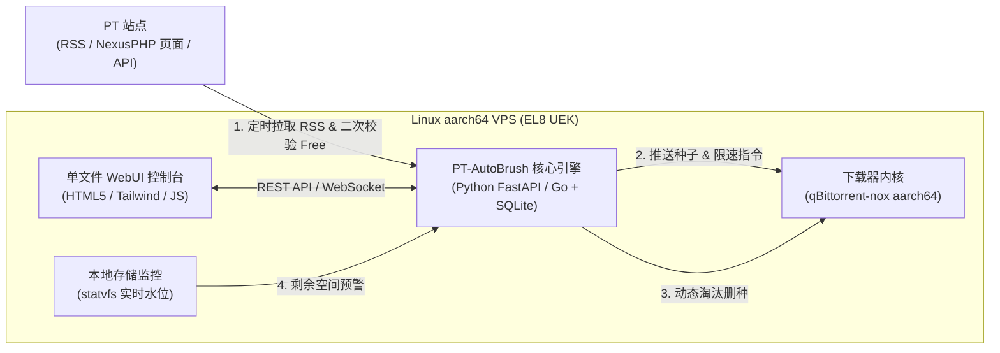

# PT 自动化刷流服务 (PT-AutoBrush) 产品需求文档 (PRD)

## 1. 背景与目标

### 1.1 目标运行环境
- **操作系统**：Linux `instance-20220808-1903` (`5.4.17-2136.352.5.el8uek.aarch64` — Oracle Linux 8 UEK, ARM64 架构)
- **环境特征**：ARM64 (`aarch64`) 架构 VPS，网络带宽充裕，但通常本地块存储容量有限（如 47GB ~ 200GB），需要高吞吐、低内存占用、严密的**防爆盘**与**防误下非免费种**机制。

### 1.2 产品定位
构建一套轻量级、自带现代化 **WebUI** 的 **PT 自动刷流（抢上传）系统**。核心解决以下痛点：
1. **只下免费种（Free / 2xFree）**：自动监听站点新种并通过多重校验确保 100% 仅下载免费种子，杜绝因误下普通种或 Free 临期失效导致分享率崩盘。
2. **全自动空间循环（防爆盘）**：根据磁盘剩余空间、上传速度、做种时间、分享率自动淘汰低效种子并清理磁盘文件，实现 $7 \times 24$ 小时无人值守刷流。
3. **防封号限速与 H&R 规避**：支持单种/全局上传限速（避免触发站点单种百兆超速封号规则）与 H&R 种子自动跳过。

---

## 2. 系统架构设计（适配 `el8uek.aarch64`）

- **下载器层**：采用 `qbittorrent-nox`（提供 `aarch64` 静态编译二进制文件自动安装脚本，无需繁琐编译依赖），也兼容外部/本地 Transmission。
- **业务与调度层**：轻量级后端（Python 3 + FastAPI + SQLite + 异步调度器），内存占用 `< 50MB`，原生兼容 EL8 `aarch64`。
- **表现层**：零构建依赖的单文件响应式 WebUI（支持暗色/亮色护眼模式、移动端自适应）。

---

## 3. 核心功能需求清单 (Feature List)

### 模块一：实时监控仪表盘 (Dashboard)
| 功能点 | 详细描述 | 优先级 |
| :--- | :--- | :---: |
| **VPS 资源遥测** | 实时展示 `aarch64` CPU 负载、内存占用、**磁盘已用/剩余空间进度条及预警状态**。 | P0 |
| **刷流吞吐统计** | 实时上传/下载速率曲线、今日上传量、今日下载量（实际消耗 vs 免费白嫖量）、累计抢到的上传总量。 | P0 |
| **全局快捷开关** | 一键开启/暂停“自动抓种”、一键触发“紧急空间清理”、服务运行状态指示。 | P0 |
| **活跃种子大盘** | 实时展示下载器中的种子列表：名称、站点、促销标签（`Free` / `2xFree`）、Free 剩余时间、进度、实时上行/下行速度、已上传量、分享率、支持手动强制删种。 | P0 |

### 模块二：PT 站点与 Free 种子嗅探器 (Site & Freeleech Sniffer)
| 功能点 | 详细描述 | 优先级 |
| :--- | :--- | :---: |
| **多站点管理** | 支持添加多个 PT 站点（名称、站点类型如 NexusPHP / M-Team API / Gazelle、RSS 地址、Cookie / Passkey / API Key、拉取周期）。 | P0 |
| **Free 状态双重校验** | **第一重**：解析 RSS 中的促销标签或专用 Free RSS； **第二重（安全锁）**：通过站点详情页/API 二次核验当前是否为 `Free` 或 `2xFree`，且**距离 Free 结束时间 $\ge N$ 分钟**（默认 60 分钟），防止下载中途变回普通种。 | P0 |
| **H&R 自动规避** | 识别带有 `H&R`（Hit and Run）考核标记的种子并自动跳过（可按站点开关）。 | P0 |
| **RSS 在线调试 (Dry-Run)** | 在 WebUI 中点击“测试抓取”，立即拉取一次该站点 RSS 并展示每条种子的命中/过滤原因。 | P1 |

### 模块三：选种过滤规则引擎 (Selection Rules)
| 功能点 | 详细描述 | 优先级 |
| :--- | :--- | :---: |
| **促销类型过滤** | 可勾选：仅 `2xFree`、或 `Free` + `2xFree`。 | P0 |
| **种子体积区间** | 设置单种最小体积（如 `2 GB`，跳过零碎小种）与最大体积（如 `50 GB`，防止单种撑爆硬盘）。 | P0 |
| **Peer 热度筛选** | 限制做种人数区间（如 `1 ~ 10` 人，只抢刚发布的新种）与最小下载人数（如 Leechers $\ge 2$）。 | P0 |
| **发布时间窗口** | 仅抓取发布时间在 $X$ 分钟以内的新种（避免拉取没人下载的老旧 Free 种）。 | P1 |
| **关键词/正则黑白名单** | 支持标题关键词包含/排除（例如排除特定拆包剧集或仅抓取热门压制组）。 | P1 |

### 模块四：自动删种与防爆盘引擎 (Auto-Cull & Disk Guard)
| 功能点 | 详细描述 | 优先级 |
| :--- | :--- | :---: |
| **磁盘安全水位线** | 设定“最低剩余空间阈值”（如 `15 GB`）：低于该值时**立即停止拉新种**，并触发自动删种释放空间。 | P0 |
| **Free 失效紧急止损** | 定时巡检“下载中（未完成）”的种子，若发现站点端 Free 状态已结束且尚未下完，立即暂停并删除，防止产生真实下载量。 | P0 |
| **达标退役与兜底淘汰** | 当分享率达到目标值（如 $\ge 3.0$）或做种时长超过上限时自动清理；空间紧缺时按**实时上传速度由低到高**依次淘汰。 | P0 |

### 模块五：下载器控制与防封号保护 (Downloader & Anti-Ban)
| 功能点 | 详细描述 | 优先级 |
| :--- | :--- | :---: |
| **下载器对接** | 配置本地 `qBittorrent` WebUI 地址、用户名、密码、默认保存路径及分类标签（如 `pt-brush` 专属分类，不误删手动下载的种子）。 | P0 |
| **单种/全局上传限速** | 支持设置单种最大上传速度（如 `45 MB/s` 或 `90 MB/s`），严格规避站点对“盒子单种超过 100MB/s”的自动封号机制。 | P0 |
| **并发队列控制** | 限制最大同时下载种子数（如 `3` 个）与最大总活跃种子数（如 `15` 个），避免磁盘 I/O 阻塞。 | P0 |
| **强制汇报加速** | 新种添加后 $N$ 秒内自动执行一次 Reannounce（强制汇报），快速连接更多新进 Peer。 | P1 |

### 模块六：运行日志与通知中心 (Audit Logs & Alerts)
| 功能点 | 详细描述 | 优先级 |
| :--- | :--- | :---: |
| **结构化审计日志** | 实时记录并分类筛选：`[抓种成功]`、`[规则跳过]`、`[自动删种]`、`[空间告警]`、`[异常错误]`。 | P0 |
| **WebUI 密码鉴权** | 访问 WebUI 需登录鉴权（支持修改管理密码），防止公网暴露被恶意操作。 | P0 |
| **消息推送 (可选)** | 支持 Telegram Bot / Webhook 推送刷流战报与 Cookie 失效告警。 | P2 |

---

## 4. 待确认事项 (与单 HTML 原型配合确认)

请结合同时生成的 **单文件交互式 HTML 原型 (`index.html`)** 确认以下细节：
1. **常刷站点类型**：您主要刷的是标准 **NexusPHP** 站点（通过 RSS + Cookie），还是包含 **M-Team（新版 API Token）**、**朱雀（TNode）** 等特殊架构站点？
2. **下载器偏好**：VPS 上是否已有 `qBittorrent` / `Transmission`，还是希望部署脚本在 `el8uek.aarch64` 上为您**全自动安装 `qbittorrent-nox` + 刷流服务**？
3. **部署方式偏好**：倾向于 **原生 Systemd 一键脚本部署**（极低资源占用）还是 **Docker Compose 部署**？
